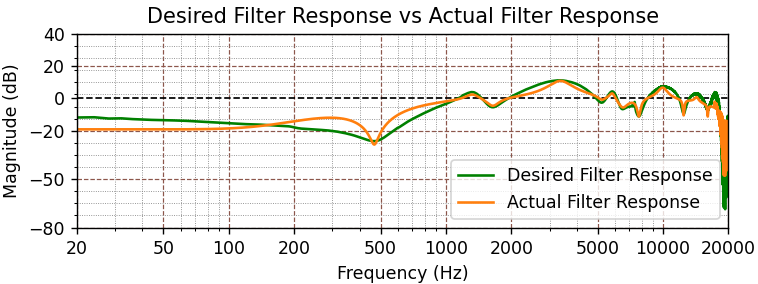

# Automatic Headphone Equalization

**Headphone-EQ-Auto** is a Python project for approximating target headphone frequency responses through digital equalization, developed for a university course in digital audio technology.

The main contribution is a **custom rule-based algorithm for automatic filter-parameter selection**. It identifies features in the desired correction response and constructs a cascade of bell/peaking and low/high-shelf **IIR filters**, represented as second-order sections (SOS).



*Example from the project report: desired correction (green) and the response of the automatically constructed parametric filter cascade (orange).*

## How It Works

The main workflow is implemented in **python/heq_7.py**:

1. Compute headphone and target magnitude responses using the FFT, then derive the desired correction from their ratio.
2. Detect peaks and dips, estimate their center frequencies, gains and Q factors, and filter out overlapping candidates.
3. Estimate low- and high-frequency shelving corrections.
4. Build and apply the SOS filter cascade, then compare the original, target and equalized responses.

The filter count follows the detected features. This is a heuristic approximation; the result depends on the response data and detection settings.

## Quick Start

Use Python 3.10-3.12 for the supplied dependency versions. From a terminal:

```bash
git clone https://github.com/PanosLelakis/Headphone-EQ-Auto.git
cd Headphone-EQ-Auto
python -m pip install -r python/requirements.txt
python python/heq_7.py
```

Run the script from the repository root so it can locate **headphone_responses/** and **targets/**. All example data is included.

The script processes **seven headphone responses against two targets**, prints the selected filter parameters and filter count, and opens one Matplotlib figure per headphone response. Close the plot windows to finish, or use the plot toolbar to save a figure.

Input paths and detection settings are defined in **python/heq_7.py**. The bundled files are mono WAV responses at 44.1 kHz; replacement inputs should have matching sampling rates, as no resampling is performed.

## Repository Contents

| Path | Purpose |
| --- | --- |
| **python/heq_7.py** | Main automatic parametric equalization workflow |
| **python/heq_1.py … heq_6.py** | Earlier studies of response analysis, FIR equalization and manually configured parametric filters |
| **python/requirements.txt** | Python dependencies |
| **headphone_responses/** | Bundled headphone response data |
| **targets/** | Bundled target response data |

## Report and References

[Read the project report (PDF, in Greek)](tasks%20%2B%20files/Headphone%20Equalization%20-%20%CE%88%CE%BA%CE%B8%CE%B5%CF%83%CE%B7.pdf).

Background study included [AutoEq](https://github.com/jaakkopasanen/AutoEq). Standard biquad coefficient formulas follow the [Audio EQ Cookbook](https://webaudio.github.io/Audio-EQ-Cookbook/audio-eq-cookbook.html).
